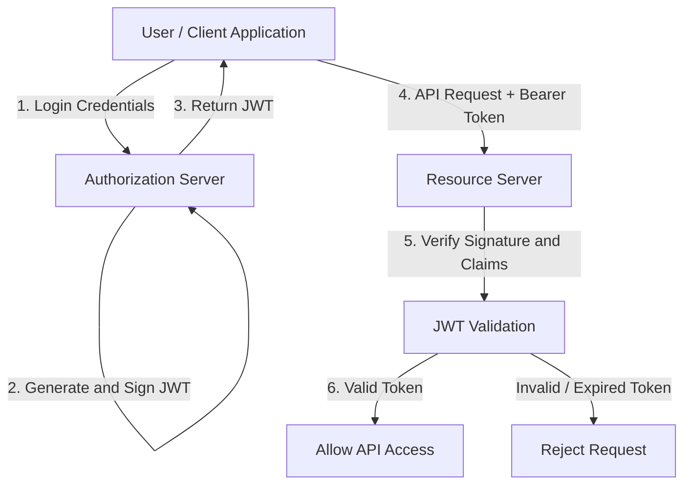

# JWT (JSON Web Token)

## 1. Definition

JWT (JSON Web Token) is a compact, URL-safe format used to securely transfer information (claims) between two parties.

- It represents information in JSON format.
- It can be digitally signed or encrypted.
- It is commonly used for authentication and authorization.
- It is often sent through the HTTP Authorization header.

**Example:** After a user logs in, the Authorization Server issues an access token. The client sends this token when accessing protected APIs.

## 2. JWT Architecture

### JWT Authentication Flow



### Flow Explanation

1. User logs in through the client application.
2. Authorization Server authenticates the user.
3. Authorization Server creates and signs a JWT.
4. Client receives the JWT.
5. Client sends the JWT with every protected API request.
6. Resource Server validates the JWT signature and required claims.
7. If valid, the request is processed; otherwise, access is rejected.

## 3. JWT Token Format

A typical signed JWT (JWS Compact Serialization) contains three parts separated by dots (`.`).

**Format:**

`Header.Payload.Signature`

```text
xxxxx.yyyyy.zzzzz
```

### Part 1: Header

Contains metadata about the token, such as the token type and signing algorithm.

Example:

```json
{
  "typ": "JWT",
  "alg": "HS256"
}
```

- `typ`: Token type.
- `alg`: Algorithm used to create the signature.

### Part 2: Payload

Contains claims, which are pieces of information about the subject or token.

Example:

```json
{
  "sub": "101",
  "name": "Vinay",
  "role": "ADMIN",
  "iss": "auth-server",
  "exp": 1900000000
}
```

- `sub`: Subject or user identifier.
- `name`: User name (custom claim).
- `role`: User role (custom claim).
- `iss`: Token issuer.
- `exp`: Token expiration time.

### Part 3: Signature

Used to verify that the token has not been modified and that it was signed by a trusted issuer.

The signature works like a security seal on a JWT.

- The Authorization Server creates a signature using the Header, Payload, and its secret/private key.
- When the Resource Server receives the JWT, it checks the signature using the appropriate key.
- If someone changes the Header or Payload, the signature check fails.
- If the signature is valid, it confirms that the token was signed by the expected issuer and its contents have not been changed.

Conceptually:

```text
Signature = Sign(
    Base64URL(Header) + "." + Base64URL(Payload),
    Signing Key
)
```

The actual signing operation depends on the selected algorithm.

**Important:** A signed JWT does not automatically encrypt its payload. Anyone who obtains it can decode and read its header and payload. Never store passwords or sensitive information in an ordinary signed JWT.

## 4. Types of JWT Claims

RFC 7519 defines three categories of claims:

### A. Registered Claims

Standard claim names defined by the specification.

| Claim | Meaning |
|---|---|
| `iss` | Issuer – who issued the token |
| `sub` | Subject – user or entity represented |
| `aud` | Audience – intended recipient |
| `exp` | Expiration time |
| `nbf` | Not valid before this time |
| `iat` | Issued at time |
| `jti` | Unique JWT identifier |

These claims are not all mandatory in every JWT. Applications define which claims they require.

### B. Public Claims

Claims with names designed to avoid naming collisions, typically registered or defined using collision-resistant names.

### C. Private Claims

Custom claims agreed upon between the token issuer and consumer.

Example:

```json
{
  "role": "ADMIN",
  "department": "IT"
}
```

## 5. JWT Real-World Example

**Scenario: E-commerce Application**

1. User logs in to the application.
2. Authorization Server validates the credentials.
3. Server generates a JWT containing the user ID and permitted claims.
4. Client receives the JWT.
5. User requests `/api/orders`.
6. Client sends:

```http
GET /api/orders HTTP/1.1
Authorization: Bearer <JWT_TOKEN>
```

7. Resource Server verifies the signature, expiration, issuer, audience, and other required claims.
8. If valid and authorized, the server returns the user's orders.

## 6. Important Interview Points

- JWT is a token format, not an authentication protocol.
- OAuth 2.0 is an authorization framework; JWT is one possible access-token format.
- OIDC uses ID Tokens, which are JWTs.
- A JWT can be signed, encrypted, or both through nested structures.
- Base64URL encoding is not encryption.
- A signature protects integrity; it does not hide the payload.
- `exp` represents expiration time in NumericDate format (seconds since Unix epoch).
- Resource Servers must validate tokens rather than simply decode them.
- Never trust claims until the token has been properly validated.

## 7. JWT vs OAuth 2.0 vs OIDC

| Concept | Purpose |
|---|---|
| OAuth 2.0 | Authorization framework |
| OIDC | Authentication layer built on OAuth 2.0 |
| JWT | Compact token format for representing claims |

## 8. Interview Questions

1. What is JWT?
2. What are the three parts of a signed JWT?
3. What is the difference between encoding and encryption?
4. What is the purpose of the JWT signature?
5. What are registered, public, and private claims?
6. What is the difference between `iss`, `sub`, and `aud`?
7. What happens when a JWT expires?
8. How does a Resource Server validate a JWT?
9. Can anyone decode a JWT payload?
10. Is JWT an authentication protocol?

## 9. Official Reference

- RFC 7519 – JWT: https://datatracker.ietf.org/doc/html/rfc7519
- Section 3 – JWT Overview
- Section 3.1 – Example JWT
- Section 4 – JWT Claims
- Section 7 – Creating and Validating JWTs