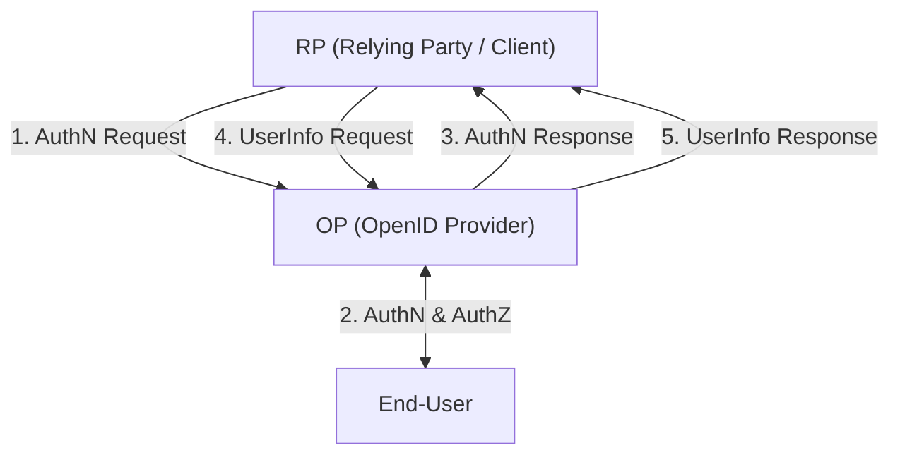

# OpenID Connect (OIDC) and Application Security

# 1. OpenID Connect (OIDC)

## 1.1 Introduction

- OpenID Connect (OIDC) is an authentication layer built on top of the OAuth 2.0 authorization framework.
- OAuth 2.0 primarily handles authorization, whereas OIDC introduces a standardized way to authenticate users.
- OIDC allows applications to verify the identity of users through an OpenID Provider (OP).
- It uses OAuth 2.0 flows and introduces an ID Token to communicate user identity.

### Example

Consider an e-commerce application.

Users can log in using:
- Application username and password.
- Google account.
- Facebook account.
- Other supported Identity Providers.

When a user selects "Sign in with Google", the application uses OIDC to authenticate the user through Google.

---

## 1.2 Important Components of OIDC

### 1. End-User
- The actual user who wants to access an application.
- Example: A customer logging into an e-commerce application.

### 2. RP (Relying Party / Client)
- The application that relies on the OpenID Provider to authenticate the user.
- Example: An e-commerce web application.

### 3. OP (OpenID Provider)
- The Identity Provider that authenticates the user.
- It provides identity information to the Relying Party.
- Example: Google.

### 4. ID Token
- A security token introduced by OIDC.
- It contains claims about the authenticated user.
- It is generally represented as a JWT.
- It helps the Relying Party verify the user's identity.

### 5. UserInfo Endpoint
- An endpoint provided by the OpenID Provider.
- The Relying Party can use an Access Token to request additional user information.
- Example: Name, email address and profile information.

---

## 1.3 Official OIDC Overview – Authentication Flow

The OpenID Connect protocol, in abstract, follows these steps.

### Step 1: Authentication Request

- The RP (Client) sends an authentication request to the OpenID Provider (OP).
- The user is redirected to the OP for authentication.

### Step 2: Authentication and Authorization

- The OP authenticates the End-User.
- The OP obtains authorization from the End-User.
- The user provides the required credentials and consent.

### Step 3: Authentication Response

- The OP responds to the RP.
- The response contains an ID Token and usually an Access Token.

### Step 4: UserInfo Request

- The RP can send a request with the Access Token to the UserInfo Endpoint.
- This request is used to retrieve additional user information(name, email, ....profile info).

### Step 5: UserInfo Response

- The UserInfo Endpoint returns claims about the End-User.
- The RP can use these claims to obtain additional profile information.

### Official Textual Architecture Diagram

### Real-Time Application Example – Flipkart Sign in with Google

**Scenario:** A user opens Flipkart and clicks **Sign in with Google**.

#### Step 1: Authentication Request

- The user clicks **Sign in with Google** on Flipkart.
- Flipkart (RP / Client Application) creates an OIDC Authentication Request.
- The browser redirects the user to Google's sign-in page.

**Real-world example:** You are redirected from Flipkart to https://accounts.google.com/ to sign in.

#### Step 2: User Authentication and Authorization

- Google (OP / OpenID Provider) asks the user to authenticate.
- The user enters their Google credentials and completes any required verification.
- Google may ask for consent to share the requested profile information with Flipkart.

**Real-world example:** You select your Google account and allow Flipkart to access the requested profile information.

#### Step 3: Authentication Response

- After successful authentication, Google sends the authentication response to Flipkart.
- In the Authorization Code Flow, Google redirects the browser to Flipkart's registered redirect URI with an authorization code.
- Flipkart's backend exchanges this code with Google for tokens.
- Google returns an ID Token and an Access Token.

**Real-world example:** After successful Google sign-in, you are redirected back to Flipkart.

#### Step 4: UserInfo Request

- Flipkart can send a UserInfo Request to Google's UserInfo endpoint.
- It sends the Access Token to retrieve additional user profile claims.

**Real-world example:** Flipkart requests permitted profile information, such as the user's name and email address.

#### Step 5: UserInfo Response

- Google validates the Access Token and returns the permitted user information.
- Flipkart uses the identity information to identify or register the user and establish an application session.

**Real-world example:** Flipkart recognizes your Google account and logs you into your Flipkart account.

#### Official Documentation Link

- https://openid.net/specs/openid-connect-core-1_0.html?utm_source=chatgpt.com
