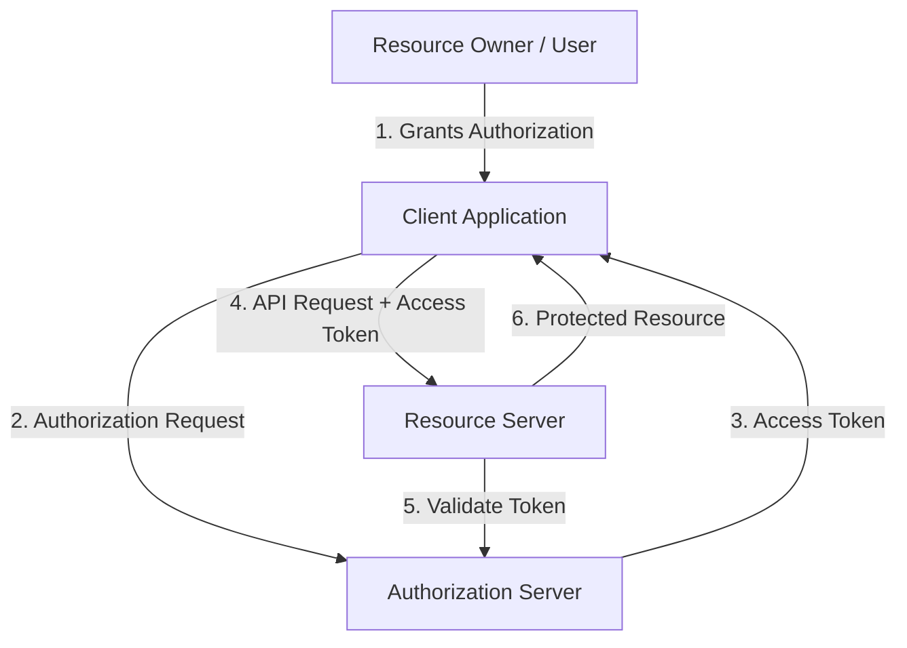
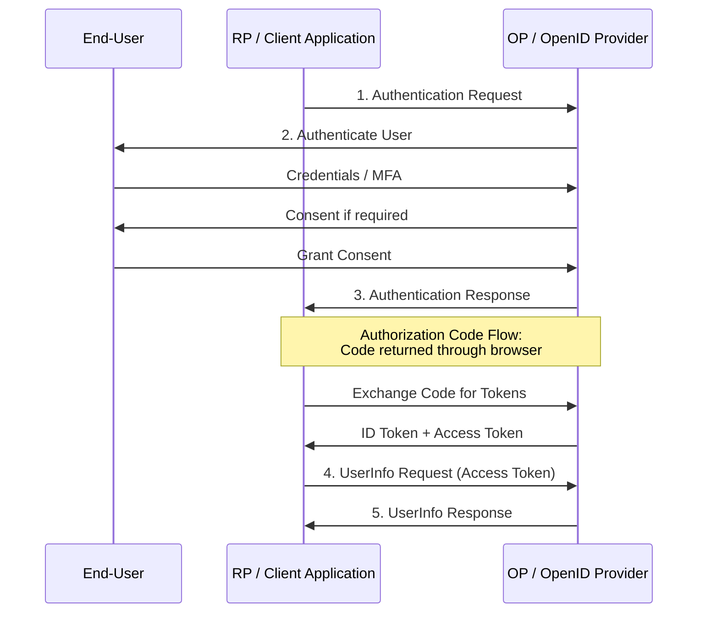
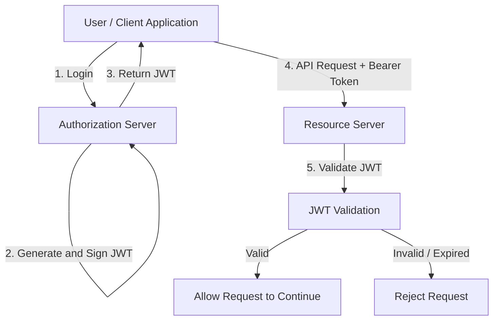
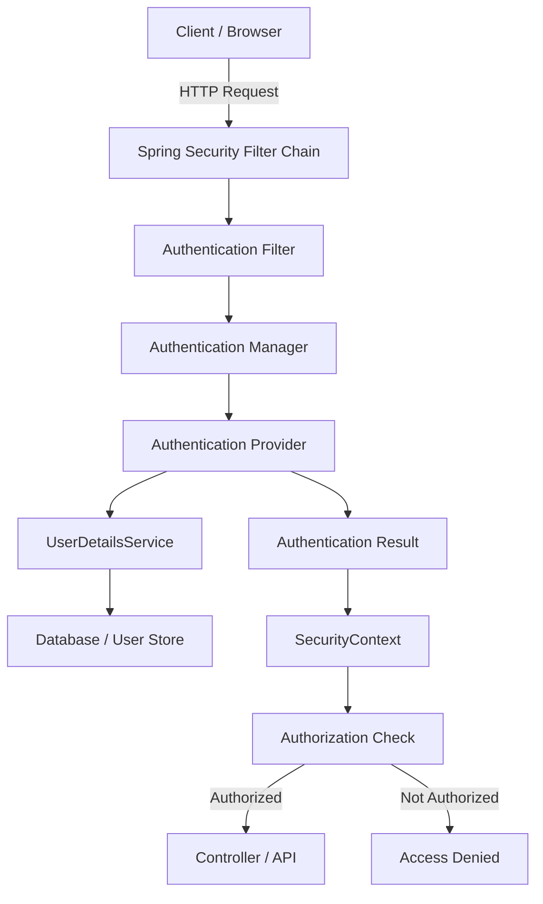
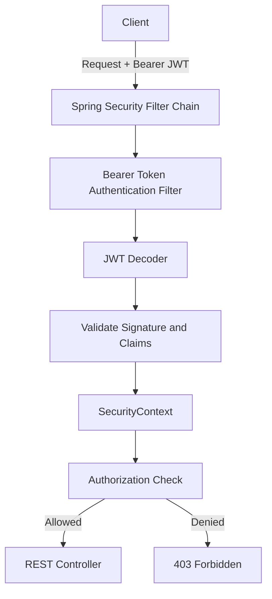
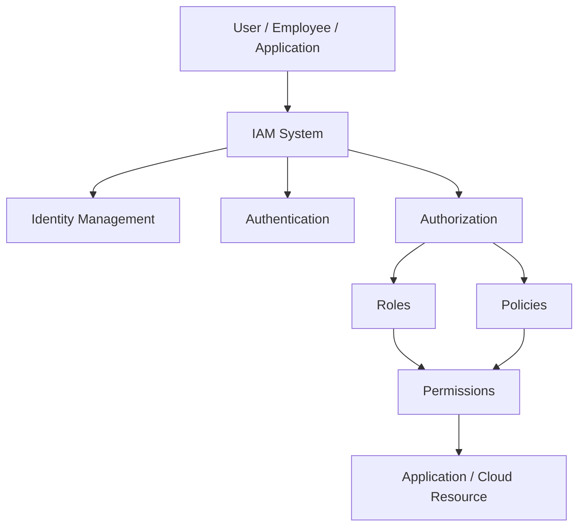
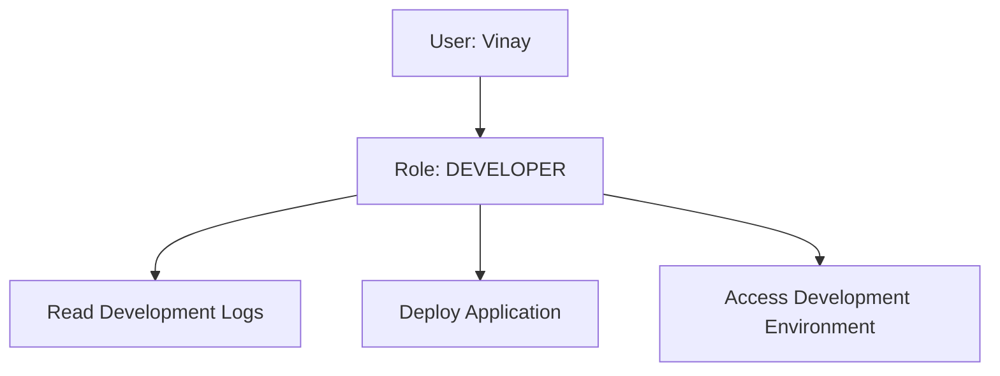
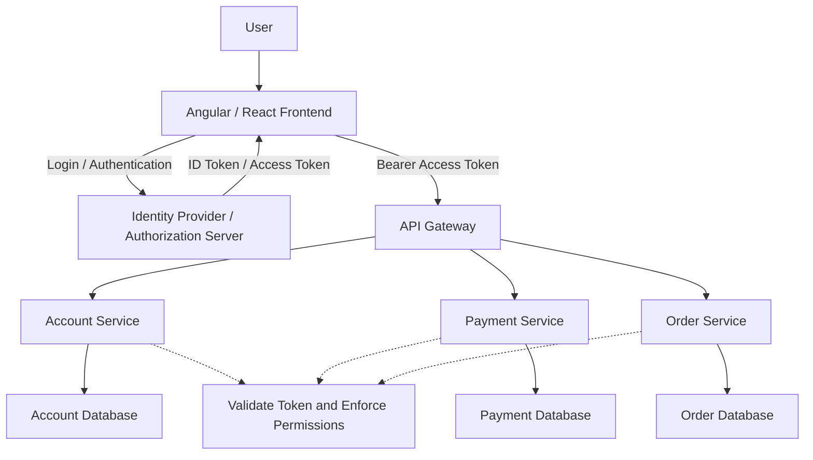
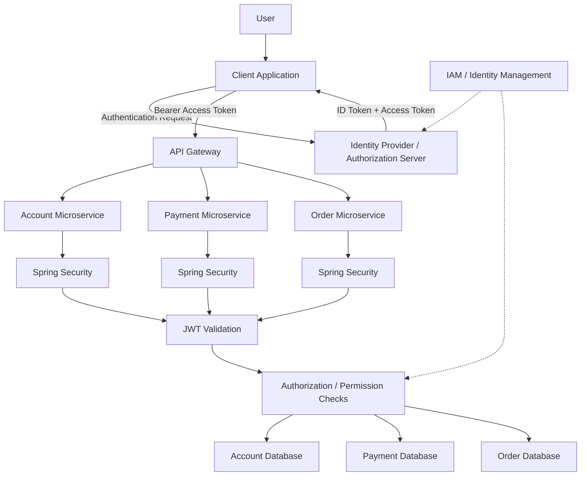

# Complete Application Security Notes
## Authentication, Authorization, OAuth 2.0, OIDC, JWT, Spring Security and IAM

---

# 1. FUNDAMENTALS OF APPLICATION SECURITY

## 1.1 What is Application Security?

Application Security refers to the practices and technologies used to protect applications, APIs, users, and data from unauthorized access and attacks.

Main objectives:

- Verify the identity of users and applications.
- Control access to resources.
- Protect sensitive information.
- Secure communication between applications.
- Prevent unauthorized modifications and data access.

Example:

In an e-commerce application:
- Only authenticated users can access their accounts.
- Users can view only their own orders.
- Only administrators can manage products.
- Payment information must be protected.

## 1.2 Authentication

Authentication means verifying the identity of a user or application.

**Interview definition:**

Authentication is the process of verifying who a user or application is before allowing access to a system.

Example:

1. User opens Flipkart.
2. User clicks Sign In.
3. User enters login credentials.
4. Application verifies the credentials.
5. If valid, the user is authenticated.

Common authentication methods:

- Username and password
- OTP
- Multi-Factor Authentication (MFA)
- Biometric authentication
- OAuth 2.0 / OpenID Connect-based login
- Digital certificates

## 1.3 Authorization

Authorization determines what an authenticated user or application is allowed to access or perform.

**Interview definition:**

Authorization is the process of determining whether an authenticated identity has permission to access a particular resource or perform a specific action.

Example:

Suppose an application has two users:

| User | Role | Permission |
|---|---|---|
| Vinay | USER | View products and own orders |
| Admin | ADMIN | Manage products and users |

Both users can authenticate successfully, but their permissions are different.

## 1.4 Authentication vs Authorization

| Authentication | Authorization |
|---|---|
| Verifies identity | Checks permissions |
| Who are you? | What can you access? |
| Validates credentials or identity proof | Evaluates roles, permissions and policies |
| Happens before authorization | Follows successful authentication |
| Example: User login | Example: Access ADMIN API |

**Remember:**

Authentication = Identity verification.

Authorization = Access control.

## 1.5 Common HTTP Security Status Codes

| Status Code | Meaning | Example |
|---|---|---|
| 200 | OK | Request successful |
| 401 | Unauthorized | Missing or invalid authentication |
| 403 | Forbidden | Authenticated user lacks permission |
| 404 | Not Found | Requested resource does not exist |

Important interview point:

- 401 means the request does not have acceptable authentication.
- 403 means the user is authenticated but is not permitted to perform the requested action.

---

# 2. OAUTH 2.0

## 2.1 Definition

OAuth 2.0 is an authorization framework that allows an application to access protected resources on behalf of a user or as an application itself, without sharing the user's password with that application.

**Example:**

Suppose a user wants to allow a third-party application to access certain Google resources.

Instead of sharing the Google password, the user grants permission through Google. Google issues an access token that the application can use to access the permitted resources.

## 2.2 Important OAuth 2.0 Components

| Component | Responsibility |
|---|---|
| Resource Owner | Entity that owns the protected resource, usually the user |
| Client | Application requesting access |
| Authorization Server | Issues access tokens after applying the required authorization process |
| Resource Server | Hosts protected APIs and validates access tokens |

### Real-World Example

Consider a third-party application accessing Google resources.

- Resource Owner: User
- Client: Third-party application
- Authorization Server: Google authorization service
- Resource Server: Google API hosting the protected resource

## 2.3 OAuth 2.0 Architecture



Note: Token validation can happen locally using a trusted signing key or through token introspection, depending on the token and architecture.

## 2.4 OAuth 2.0 Grant Types

Grant types define how a client obtains an access token.

### A. Authorization Code Flow

Used for applications where a user signs in and authorizes access.

Flow:

1. Client redirects the user to the Authorization Server.
2. User authenticates and grants permission.
3. Authorization Server redirects the browser to the client's redirect URI with an authorization code.
4. Client exchanges the code for tokens.
5. Client uses the access token to access protected resources.

Modern applications should generally use Authorization Code Flow with PKCE.

### B. Client Credentials Flow

Used for machine-to-machine communication.

Example:

Payment Service needs to communicate with Notification Service.

1. Payment Service sends its client ID and client secret to the Authorization Server.
2. Authorization Server validates the client.
3. Authorization Server issues an access token.
4. Payment Service uses the token to call Notification Service.

Important:

- No user login is involved.
- It represents the application itself.
- A refresh token is normally not issued in Client Credentials Flow.
- When the access token expires, the application obtains another token using its client credentials.

### C. Refresh Token Grant

Used to obtain a new access token without requiring the user to authenticate again, subject to the authorization server's policies.

1. Client sends the refresh token to the Authorization Server.
2. Authorization Server validates it.
3. Authorization Server issues a new access token.
4. It may also issue a rotated refresh token.

## 2.5 Access Token vs Refresh Token

| Access Token | Refresh Token |
|---|---|
| Used to access protected APIs | Used to obtain a new access token |
| Usually short-lived | Usually longer-lived |
| Sent to Resource Server | Sent only to Authorization Server |
| Contains or represents access permissions | Used to maintain an authorized session |

Important:

Never send a refresh token to a Resource Server as an API access token.

---

# 3. OPENID CONNECT (OIDC)

## 3.1 Definition

OpenID Connect (OIDC) is an authentication layer built on top of OAuth 2.0.

OAuth 2.0 focuses on authorization, whereas OIDC adds standardized user authentication and identity information.

**Example:**

When a user clicks "Sign in with Google" on an e-commerce application, the application can use OIDC to authenticate the user through Google.

## 3.2 Important OIDC Components

| Component | Responsibility |
|---|---|
| RP | Relying Party – client application |
| OP | OpenID Provider – identity provider |
| End-User | Person trying to sign in |
| ID Token | Communicates authenticated user identity |
| Access Token | Used to access protected resources |
| UserInfo Endpoint | Returns additional user claims |

## 3.3 Official OIDC Authentication Flow

### Architecture Diagram



### Step 1: Authentication Request

- The RP (Client) sends an authentication request to the OP.
- The user is redirected to the OP for authentication.

Real-world example:

You open Flipkart and click Sign in with Google. Your browser is redirected to Google's sign-in page.

Google sign-in: https://accounts.google.com/

### Step 2: User Authentication and Authorization

- OP authenticates the End-User.
- OP may ask for consent to share requested profile information.

Real-world example:

You select your Google account and complete authentication. Google may ask whether you allow the application to access your profile information.

### Step 3: Authentication Response

- OP sends an authentication response to the RP.
- In Authorization Code Flow, the browser receives an authorization code through the registered redirect URI.
- The client exchanges the code for tokens.
- The response includes an ID Token and may include an Access Token.

Real-world example:

After successful Google authentication, you are redirected back to Flipkart.

### Step 4: UserInfo Request

- RP sends a request to the UserInfo endpoint using the Access Token.
- This request retrieves additional user claims.

Real-world example:

Flipkart requests permitted user profile information from Google.

### Step 5: UserInfo Response

- OP returns the requested user information.
- RP uses the identity information to identify or register the user and establish an application session.

Real-world example:

Flipkart recognizes your Google account and signs you into your Flipkart account.

Important:

This is an illustrative flow. The exact consent screens and UserInfo request depend on the application's configuration. Google authentication does not automatically create a Flipkart account; Flipkart must handle account creation or account linking.

## 3.4 ID Token vs Access Token

| ID Token | Access Token |
|---|---|
| Used to communicate user identity | Used to access protected resources |
| Issued as part of OIDC | Used in OAuth 2.0 and OIDC |
| Contains authentication-related claims | Represents granted access |
| Intended for the OIDC Client | Intended for the Resource Server |

Important:

An ID Token should not be used as an API access token.

## 3.5 OAuth 2.0 vs OIDC

| OAuth 2.0 | OIDC |
|---|---|
| Authorization framework | Authentication layer built on OAuth 2.0 |
| Provides access delegation | Provides standardized user authentication |
| Uses access tokens | Uses ID Tokens and can also use access tokens |
| Answers: What can the client access? | Answers: Who authenticated? |

---

# 4. JWT – JSON WEB TOKEN

## 4.1 Definition

JWT (JSON Web Token) is a compact, URL-safe format used to represent claims and transfer information between parties.

- It represents information in JSON format.
- It can be digitally signed or encrypted.
- It is commonly used as an access-token format.
- It is often sent through the HTTP Authorization header.

Example:

After a user logs in, the Authorization Server issues an access token. The client sends the token when accessing protected APIs.

## 4.2 JWT Architecture



## 4.3 JWT Token Format

A typical signed JWT using JWS Compact Serialization has three parts separated by dots.

Format:

`Header.Payload.Signature`

```text
xxxxx.yyyyy.zzzzz
```

### Part 1: Header

Contains metadata about the token.

Example:

```json
{
  "typ": "JWT",
  "alg": "HS256"
}
```

- typ: Token type.
- alg: Signing algorithm.

### Part 2: Payload

Contains claims, which are pieces of information about the subject or token.

Example:

```json
{
  "sub": "101",
  "name": "Vinay",
  "role": "ADMIN",
  "iss": "auth-server",
  "exp": 1900000000
}
```

- sub: Subject or user identifier.
- name: User name.
- role: Custom role claim.
- iss: Token issuer.
- exp: Token expiration time.

### Part 3: Signature

The signature works like a security seal on a JWT.

- The Authorization Server creates a signature using the Header, Payload, and its secret/private key.
- When the Resource Server receives the JWT, it checks the signature using the appropriate key.
- If someone changes the Header or Payload, the original signature will no longer match.
- The Resource Server rejects a token whose signature is invalid.

Example:

Original payload:

```json
{
  "name": "Vinay",
  "role": "USER"
}
```

Someone changes the role:

```json
{
  "name": "Vinay",
  "role": "ADMIN"
}
```

The original signature will no longer match the modified token.

Remember:

Signature = Security seal that helps detect unauthorized changes to the token.

## 4.4 JWT Claims

Claims are statements about the subject or token.

RFC 7519 defines three categories.

### A. Registered Claims

Standard claim names defined by the specification.

| Claim | Meaning |
|---|---|
| iss | Issuer |
| sub | Subject |
| aud | Audience |
| exp | Expiration time |
| nbf | Not valid before |
| iat | Issued at |
| jti | Unique JWT identifier |

These claims are not all mandatory in every JWT. Applications define which claims they require.

### B. Public Claims

Claims with names designed to avoid naming collisions. They may be registered or use collision-resistant names.

### C. Private Claims

Custom claims agreed upon between the token issuer and consumer.

Example:

```json
{
  "role": "ADMIN",
  "department": "IT"
}
```

## 4.5 How Resource Server Validates JWT

1. Extract the Bearer token from the Authorization header.
2. Verify the token's signature using a trusted key.
3. Validate the expiration time.
4. Validate the issuer.
5. Validate the audience when required.
6. Check other required claims and permissions.
7. If valid, continue with authorization checks.

## 4.6 Important JWT Interview Points

- JWT is a token format, not an authentication protocol.
- OAuth 2.0 is an authorization framework.
- OIDC ID Tokens are JWTs.
- A JWT can be signed, encrypted, or both.
- Base64URL encoding is not encryption.
- Anyone who obtains an ordinary signed JWT can decode its payload.
- A signature protects integrity but does not hide the payload.
- Never store passwords or sensitive information in an ordinary signed JWT.

---

# 5. AUTHORIZATION SERVER AND RESOURCE SERVER

## 5.1 Authorization Server

An Authorization Server is responsible for issuing tokens after applying the required authentication and authorization process.

Responsibilities:

- Authenticate users or clients as applicable.
- Process authorization requests.
- Issue access tokens.
- Issue ID Tokens when operating as an OIDC Provider.
- Issue and manage refresh tokens when supported.
- Publish signing keys or provide token introspection services.

Examples:

- Microsoft Entra ID
- Keycloak
- Okta
- Spring Authorization Server

## 5.2 Resource Server

A Resource Server hosts protected APIs and validates access tokens before allowing access.

Responsibilities:

- Receive API requests.
- Extract access tokens.
- Validate tokens.
- Enforce access permissions.
- Return protected resources.

Example:

An Account Service exposes:

`GET /api/accounts`

It requires a valid access token before returning account information.

## 5.3 Authorization Server vs Resource Server

| Authorization Server | Resource Server |
|---|---|
| Issues access tokens | Accepts access tokens |
| Manages token issuance | Validates tokens |
| Handles authorization requests | Protects APIs |
| Example: Keycloak | Example: Account Service |

They can be separate systems or logically separate roles within the same deployment.

---

# 6. SPRING SECURITY

## 6.1 Definition

Spring Security is a security framework for Java applications, especially Spring Boot applications.

It provides:

- Authentication
- Authorization
- Password security
- Protection against common security attacks
- Integration with OAuth 2.0, OIDC and JWT

Example:

In an e-commerce application, authenticated users can access their orders, but only ADMIN users can manage products.

## 6.2 Spring Security Architecture



Note:

The exact flow depends on the authentication mechanism. For example, JWT Resource Server authentication uses a Bearer Token Authentication Filter and JWT Decoder; it does not necessarily load user details from a database on every request.

## 6.3 Important Spring Security Components

| Component | Responsibility |
|---|---|
| Security Filter Chain | Applies security filters to incoming requests |
| Authentication Filter | Extracts authentication information |
| AuthenticationManager | Coordinates authentication |
| AuthenticationProvider | Performs actual authentication |
| UserDetailsService | Loads user details |
| PasswordEncoder | Encodes and verifies passwords |
| SecurityContext | Stores current authentication information |
| AuthorizationManager | Determines whether access is allowed |

## 6.4 Authentication vs Authorization in Spring Security

Authentication example:

User submits username and password. Spring Security verifies the credentials.

Authorization example:

The user tries to access `/api/admin/users`. Spring Security checks whether the user has the ADMIN role.

## 6.5 PasswordEncoder

Spring Security provides PasswordEncoder to securely store and verify passwords.

Example:

```java
@Bean
public PasswordEncoder passwordEncoder() {
    return new BCryptPasswordEncoder();
}
```

Important:

- Never store plain-text passwords.
- BCrypt is a password hashing algorithm.
- Passwords are hashed, not encrypted.
- During login, the entered password is checked against the stored hash.

## 6.6 Role-Based Authorization Example

Suppose an e-commerce application has two roles:

- USER – Can view products and their own orders.
- ADMIN – Can manage products and users.

Example:

```java
@Configuration
@EnableWebSecurity
public class SecurityConfig {

    @Bean
    public SecurityFilterChain securityFilterChain(
            HttpSecurity http) throws Exception {

        http
            .authorizeHttpRequests(auth -> auth
                .requestMatchers("/api/admin/**")
                    .hasRole("ADMIN")
                .requestMatchers("/api/user/**")
                    .hasAnyRole("USER", "ADMIN")
                .anyRequest().authenticated()
            )
            .httpBasic(Customizer.withDefaults());

        return http.build();
    }
}
```

Explanation:

- `/api/admin/**` requires ADMIN role.
- `/api/user/**` requires USER or ADMIN role.
- Other endpoints require authentication.
- HTTP Basic is used here for demonstration.

## 6.7 Spring Security with JWT

Spring Security provides OAuth 2.0 Resource Server support for validating JWT access tokens.



Flow:

1. Client sends JWT in the Authorization header.
2. Spring Security extracts the Bearer token.
3. JWT Decoder validates the signature and required claims.
4. Authentication information is established in SecurityContext.
5. Authorization rules are evaluated.
6. If permitted, the request reaches the controller.

Example:

```http
GET /api/orders HTTP/1.1
Authorization: Bearer <JWT_TOKEN>
```

Important:

A custom JWT filter is not always required. Spring Security's Resource Server support can handle standard JWT Bearer token validation.

---

# 7. IAM – IDENTITY AND ACCESS MANAGEMENT

## 7.1 Definition

IAM stands for Identity and Access Management.

IAM is a system or framework used to manage identities and control access to applications, systems, and resources.

It manages:

- Identities – Who can access a system?
- Roles – What category of access does an identity have?
- Policies – What access rules should be applied?
- Permissions – What actions are allowed?

Example:

A company uses IAM to manage employee access to applications, databases, cloud infrastructure, and other resources.

## 7.2 IAM Architecture



Flow:

1. User or application requests access.
2. IAM identifies the identity.
3. Authentication verifies the identity.
4. Authorization evaluates roles, policies and permissions.
5. Access is granted or denied.

## 7.3 Important IAM Concepts

### A. Identity

Represents a user, application, service, or other entity that needs access.

Examples:

- Employee: Vinay
- Application: Payment Service
- Service Identity: Backend Application

### B. Role

A collection of permissions assigned to an identity.

Example:

| Role | Access |
|---|---|
| ADMIN | Manage users and products |
| DEVELOPER | Access development resources |
| VIEWER | Read-only access |

### C. Policy

A set of rules defining which actions are allowed or denied on particular resources.

Example:

An AWS IAM policy can allow a user to read objects from a particular S3 bucket but deny object deletion.

### D. Permission

Defines an individual action an identity is allowed to perform.

Examples:

- Read a file.
- Create a database.
- Delete a resource.
- Deploy an application.

## 7.4 IAM vs RBAC

RBAC stands for Role-Based Access Control.

It is an authorization model in which permissions are assigned to roles, and users or identities receive permissions through those roles.

Example:



| IAM | RBAC |
|---|---|
| Broad identity and access management concept | Authorization model |
| Manages identities and access controls | Assigns permissions through roles |
| Can support multiple authorization models | Groups permissions into roles |

---

# 8. API GATEWAY AND MICROSERVICES SECURITY

## 8.1 What is API Gateway?

API Gateway is a single entry point for client requests in a microservices architecture.

Responsibilities can include:

- Request routing
- Authentication and token validation
- Rate limiting
- Logging
- Load balancing
- Common security policies

Example:

An Angular frontend sends requests to the API Gateway. The Gateway routes them to Account, Payment, or Order services.

## 8.2 Microservices Security Architecture



## 8.3 Complete Request Flow

1. User opens the frontend application.
2. User authenticates through the Identity Provider.
3. Authorization Server issues the required tokens.
4. Frontend stores tokens using an appropriate secure strategy.
5. Frontend sends an access token with API requests.
6. API Gateway applies common security checks and routes requests.
7. Each protected microservice validates the token and enforces its own authorization rules.
8. The requested business operation is executed.
9. Response is returned to the client.

Important:

- Gateway-level validation does not automatically replace service-level security.
- Each protected Resource Server should enforce its own security requirements.
- Each microservice should verify that the user has permission to perform the requested business operation.

## 8.4 Centralized Authentication vs Distributed Authorization

Centralized authentication:

- A common Identity Provider authenticates users.
- A common Authorization Server issues tokens.
- Users can use Single Sign-On (SSO) across applications when configured.

Distributed authorization:

- Each microservice enforces permissions relevant to its business operations.
- Account Service controls account access.
- Payment Service controls payment operations.
- Order Service controls order operations.

This keeps identity management centralized while business authorization remains close to the service that owns the business functionality.

---

# 9. CLOUD IAM – MICROSOFT ENTRA ID AND AZURE RBAC

## 9.1 Microsoft Entra ID

Microsoft Entra ID is Microsoft's cloud identity and access management service.

It supports:

- User and group management
- Authentication
- Single Sign-On
- Multi-Factor Authentication
- Application identities
- Token issuance

Example:

An employee signs in to a company's Microsoft account and accesses authorized applications.

## 9.2 Azure RBAC

Azure Role-Based Access Control manages who can access Azure resources and what actions they can perform.

Example:

A developer needs access to an Azure resource group.

The company assigns the developer the Reader role.

The developer can view resources but cannot modify them.

Common built-in roles:

| Role | Responsibility |
|---|---|
| Owner | Full access, including role assignment |
| Contributor | Manage resources but cannot assign roles |
| Reader | View resources |
| User Access Administrator | Manage access to Azure resources |

## 9.3 Azure RBAC Scope

Azure RBAC permissions can be assigned at different scopes:

- Management Group
- Subscription
- Resource Group
- Individual Resource

Permissions assigned at a broader scope can be inherited by child scopes, subject to Azure RBAC rules.

## 9.4 Managed Identity

Managed Identity provides an identity to an Azure-hosted application so it can authenticate to supported Azure services without storing credentials in application code.

Example:

A Spring Boot application running in Azure App Service needs to access Azure Key Vault.

Without Managed Identity:
- Application may require a client secret.
- Secret must be stored and rotated securely.

With Managed Identity:
- Azure provides an identity to the application.
- The application obtains an access token.
- Key Vault checks whether that identity has permission.
- The application accesses the permitted secret.

Important distinction:

- Microsoft Entra ID manages identities and authentication.
- Azure RBAC controls authorization to Azure resources.
- Managed Identity provides an application identity without requiring embedded credentials.

---

# 10. HOW ALL SECURITY COMPONENTS WORK TOGETHER

## 10.1 Overall Security Architecture



## 10.2 Responsibility of Each Component

| Component | Responsibility |
|---|---|
| Authentication | Verifies identity |
| Authorization | Determines permitted actions |
| OAuth 2.0 | Provides authorization framework |
| OIDC | Adds authentication and identity information |
| JWT | Represents claims in a compact token format |
| Authorization Server | Issues tokens |
| Resource Server | Protects APIs and validates access tokens |
| Spring Security | Implements application-level security |
| IAM | Manages identities and access |
| RBAC | Controls access through roles |
| API Gateway | Provides a common API entry point and security enforcement |
| Identity Provider | Authenticates identities |

## 10.3 Complete Real-World Example

Scenario: A user places an order in an e-commerce application.

Step 1 – Authentication:

The user clicks Sign in with Google.

OIDC redirects the user to Google's authentication page.

Step 2 – Token Issuance:

Google authenticates the user and returns an authentication response.

The application obtains the required tokens.

Step 3 – API Request:

The frontend sends the access token to the API Gateway.

Step 4 – Token Validation:

The Gateway and protected microservices apply their required token validation.

Step 5 – Authorization:

Spring Security checks whether the authenticated user is permitted to place an order.

Step 6 – Business Operation:

Order Service creates the order.

Step 7 – Response:

The application returns the order confirmation to the user.

In this example:

- OIDC handles user authentication.
- OAuth 2.0 provides the authorization framework.
- JWT may be used as the access-token format.
- API Gateway routes the request.
- Spring Security protects the microservices.
- IAM manages identities and broader access policies.
- Authorization rules control which business operations the user can perform.

---

# 11. IMPORTANT SECURITY CONCEPTS

## 11.1 Single Sign-On (SSO)

SSO allows a user to authenticate once and access multiple applications without independently signing in to each application, subject to the configured identity and session policies.

Example:

An employee signs in to the company identity provider and accesses email, HR, and internal applications.

## 11.2 Multi-Factor Authentication (MFA)

MFA requires two or more different authentication factors.

Examples:

- Password + OTP
- Password + Biometric
- Password + Security Key

## 11.3 Least Privilege Principle

Users and applications should receive only the minimum permissions required to perform their tasks.

Example:

A developer who only needs to view production logs should not receive full production administrator access.

## 11.4 Stateless vs Stateful Authentication

| Stateless | Stateful |
|---|---|
| Server does not need to maintain a traditional login session for every client | Server maintains session information |
| Commonly uses self-contained access tokens | Commonly uses server-side sessions |
| Token carries claims | Session ID identifies server-side session |
| Requires token validation on requests | Requires session lookup or validation |

Important:

JWT is commonly used for stateless API authentication, but JWT does not automatically make an entire application stateless.

## 11.5 Encryption vs Hashing vs Digital Signature

| Concept | Purpose | Example |
|---|---|---|
| Encryption | Protects confidentiality | AES |
| Hashing | One-way transformation | SHA-256, BCrypt for passwords |
| Digital Signature | Verifies integrity and authenticity | RSA, ECDSA |

Important:

- Passwords should be stored using secure password hashing.
- JWT signing is different from JWT encryption.
- A signed JWT payload is not automatically confidential.

---

# 12. INTERVIEW REVISION – IMPORTANT QUESTIONS

## Authentication and Authorization

1. What is authentication?
2. What is authorization?
3. What is the difference between authentication and authorization?
4. What is the difference between 401 and 403?
5. What is Single Sign-On?
6. What is Multi-Factor Authentication?
7. What is the principle of least privilege?

## OAuth 2.0 and OIDC

1. What is OAuth 2.0?
2. Why do we need OAuth 2.0?
3. What are the four OAuth 2.0 roles?
4. What is Authorization Code Flow?
5. What is Client Credentials Flow?
6. What is a Refresh Token?
7. What is the difference between Access Token and Refresh Token?
8. What is OIDC?
9. What is the difference between OAuth 2.0 and OIDC?
10. What is the difference between ID Token and Access Token?
11. What are RP and OP?
12. What is the UserInfo endpoint?

## JWT

1. What is JWT?
2. What are the three parts of a JWT?
3. What is the purpose of the signature?
4. What are registered, public, and private claims?
5. What is the difference between iss, sub, and aud?
6. Is Base64URL encoding encryption?
7. Can anyone decode a JWT payload?
8. How does a Resource Server validate a JWT?
9. What happens when a JWT expires?
10. What is the difference between signing and encryption?

## Authorization Server and Resource Server

1. What is an Authorization Server?
2. What is a Resource Server?
3. Can they be the same application?
4. Who issues access tokens?
5. Who validates access tokens?
6. What happens when a token is invalid?

## Spring Security

1. What is Spring Security?
2. Explain Spring Security Filter Chain.
3. What is AuthenticationManager?
4. What is AuthenticationProvider?
5. What is UserDetailsService?
6. What is SecurityContext?
7. What is PasswordEncoder?
8. How does BCrypt work?
9. How does Spring Security validate JWT?
10. How do you implement role-based authorization?
11. What is the difference between hasRole() and hasAuthority()?
12. Is a custom JWT filter always required?

## IAM

1. What is IAM?
2. What is an identity?
3. What is a role?
4. What is a policy?
5. What is a permission?
6. What is RBAC?
7. What is the difference between IAM and Spring Security?
8. What is Microsoft Entra ID?
9. What is Azure RBAC?
10. What is Managed Identity?

## Microservices Security

1. How do you secure microservices?
2. What is the role of API Gateway in security?
3. How does JWT authentication work across microservices?
4. Should every microservice validate the token?
5. What is centralized authentication?
6. What is distributed authorization?
7. How do microservices communicate securely?
8. How do you implement service-to-service authentication?

---

# 13. QUICK REVISION TABLE

| Term | One-Line Explanation |
|---|---|
| Authentication | Verifies who you are |
| Authorization | Determines what you can access |
| OAuth 2.0 | Authorization framework |
| OIDC | Authentication layer built on OAuth 2.0 |
| JWT | Compact token format |
| ID Token | Communicates authenticated user identity |
| Access Token | Used to access protected resources |
| Refresh Token | Obtains a new access token |
| Authorization Server | Issues tokens |
| Resource Server | Hosts protected APIs |
| Identity Provider | Authenticates identities |
| RP | OIDC Client Application |
| OP | OIDC Provider |
| Spring Security | Secures Spring applications |
| Security Filter Chain | Processes requests through security filters |
| AuthenticationManager | Coordinates authentication |
| AuthenticationProvider | Performs authentication |
| UserDetailsService | Loads user details |
| PasswordEncoder | Hashes and verifies passwords |
| SecurityContext | Holds current authentication information |
| IAM | Manages identities and access |
| Identity | User or application |
| Role | Collection of permissions |
| Policy | Rules defining access |
| Permission | Allowed action |
| RBAC | Role-Based Access Control |
| API Gateway | Common API entry point |
| SSO | Single Sign-On |
| MFA | Multi-Factor Authentication |
| Managed Identity | Azure-provided application identity |

---

# 14. OFFICIAL DOCUMENTATION

## OAuth 2.0
https://datatracker.ietf.org/doc/html/rfc6749

## OpenID Connect
https://openid.net/specs/openid-connect-core-1_0.html

## JWT
https://datatracker.ietf.org/doc/html/rfc7519

## Spring Security
https://docs.spring.io/spring-security/reference/

## Spring Security Architecture
https://docs.spring.io/spring-security/reference/servlet/architecture.html

## Spring OAuth 2.0 Resource Server
https://docs.spring.io/spring-security/reference/servlet/oauth2/resource-server/

## Microsoft Entra ID
https://learn.microsoft.com/en-us/entra/identity/

## Azure RBAC
https://learn.microsoft.com/en-us/azure/role-based-access-control/