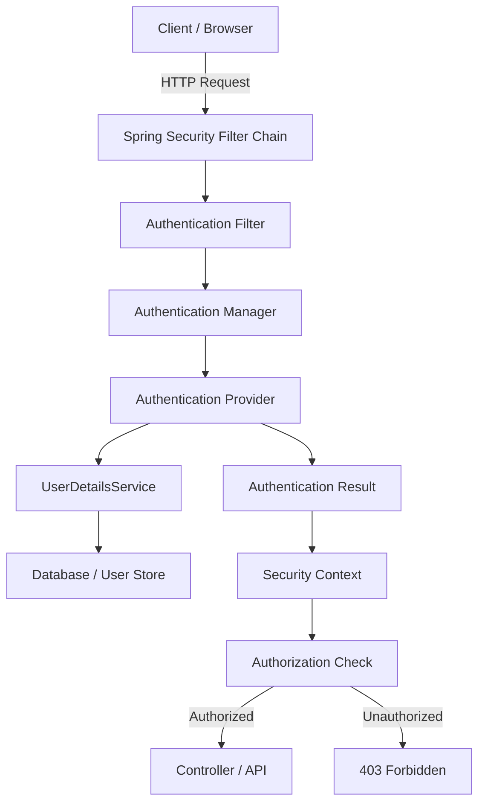
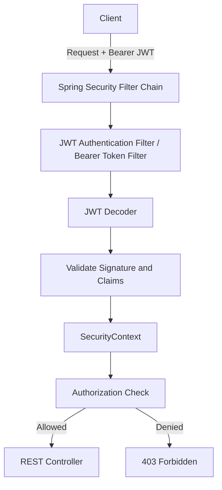
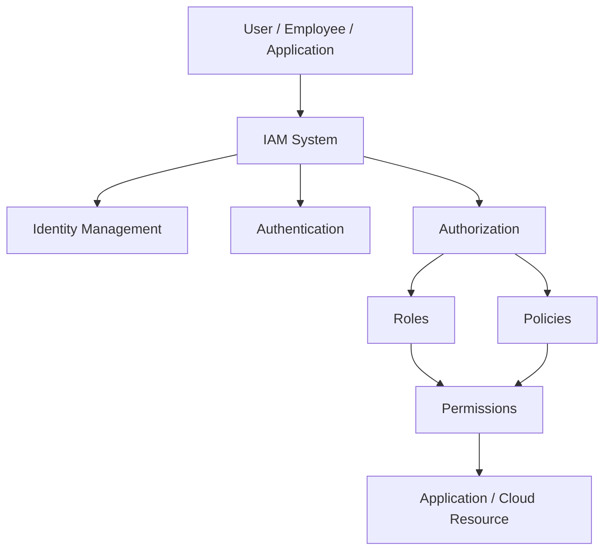

# Spring Security and IAM

# PART 1: SPRING SECURITY

## 1. Definition

Spring Security is a security framework for Java applications, especially Spring Boot applications.

It provides:
- Authentication – verifies who the user is.
- Authorization – checks what the user is allowed to access.
- Protection against common security attacks.
- Integration with OAuth 2.0, OIDC, and JWT.

**Example:** In an e-commerce application, only authenticated users can access their orders, while only ADMIN users can access admin APIs.

## 2. Spring Security Architecture

### Request Flow



### Flow Explanation

1. Client sends an HTTP request.
2. Request passes through the Spring Security Filter Chain.
3. Authentication Filter extracts the credentials or token.
4. Authentication Manager manages the authentication process.
5. Authentication Provider validates the credentials or token.
6. UserDetailsService can load user information from the database.
7. Successful authentication is stored in the SecurityContext.
8. Authorization checks whether the user has the required permission.
9. If authorized, the request reaches the controller.

**Note:** The exact flow depends on the authentication mechanism. For example, JWT authentication does not necessarily use UserDetailsService on every request.

## 3. Authentication vs Authorization

| Authentication | Authorization |
|---|---|
| Verifies user identity | Checks user permissions |
| Who are you? | What can you access? |
| Happens before authorization | Happens after authentication |
| Example: Login | Example: Access ADMIN API |

**Example:**

- Vinay logs in using username and password – Authentication.
- Vinay tries to access `/api/admin/users` – Authorization.
- If Vinay does not have ADMIN permission, access is denied.

## 4. Important Spring Security Components

| Component | Responsibility |
|---|---|
| Security Filter Chain | Applies security filters to incoming requests |
| Authentication Filter | Extracts authentication information |
| Authentication Manager | Coordinates authentication |
| Authentication Provider | Performs actual authentication |
| UserDetailsService | Loads user details |
| PasswordEncoder | Encodes and verifies passwords |
| SecurityContext | Stores the current authenticated user's security information |
| Authorization Manager | Determines whether access is allowed |

## 5. Practical Spring Boot Example

### Scenario: Role-Based Authorization

An e-commerce application has two roles:

- USER – Can view products and their own orders.
- ADMIN – Can manage products and users.

Example:

```java
@Configuration
@EnableWebSecurity
public class SecurityConfig {

    @Bean
    public SecurityFilterChain securityFilterChain(
            HttpSecurity http) throws Exception {

        http
            .authorizeHttpRequests(auth -> auth
                .requestMatchers("/api/admin/**")
                    .hasRole("ADMIN")
                .requestMatchers("/api/user/**")
                    .hasAnyRole("USER", "ADMIN")
                .anyRequest().authenticated()
            )
            .httpBasic(Customizer.withDefaults());

        return http.build();
    }
}
```

**Explanation:**

- `/api/admin/**` requires ADMIN role.
- `/api/user/**` requires USER or ADMIN role.
- Other endpoints require authentication.
- HTTP Basic is used here only for a simple demonstration.

## 6. PasswordEncoder

Spring Security provides PasswordEncoder to securely store and verify passwords.

Example:

```java
@Bean
public PasswordEncoder passwordEncoder() {
    return new BCryptPasswordEncoder();
}
```

**Important:**
- Never store plain-text passwords.
- BCrypt is a password hashing algorithm.
- Passwords are hashed, not encrypted.
- During login, the entered password is checked against the stored hash.

## 7. Spring Security with JWT

In stateless REST APIs, Spring Security can validate JWT access tokens.



**Explanation:**

1. Client sends a JWT in the Authorization header.
2. Spring Security extracts the Bearer token.
3. JWT Decoder validates the signature and required claims.
4. Authentication information is established in the SecurityContext.
5. Authorization rules are evaluated.
6. If permitted, the request reaches the controller.

Example header:

```http
Authorization: Bearer <JWT_TOKEN>
```

**Important:** Spring Security provides OAuth 2.0 Resource Server support for JWT validation. A custom JWT filter is not always required.

---

# PART 2: IAM (IDENTITY AND ACCESS MANAGEMENT)

## 1. Definition

IAM stands for Identity and Access Management.

IAM is a system used to manage:
- Identities – Who can access a system?
- Roles – What category of access does a user have?
- Policies – What access rules should be applied?
- Permissions – What actions are allowed?

**Example:** In a company, IAM manages employee identities and determines which applications and cloud resources each employee can access.

## 2. IAM Architecture



### Flow Explanation

1. User or application requests access.
2. IAM identifies the identity.
3. Authentication verifies the identity.
4. IAM evaluates roles, policies, and permissions.
5. Access is granted or denied based on the applicable rules.

## 3. Important IAM Concepts

### A. Identity

Represents a user, application, service, or other entity that needs access.

Example:
- Employee: Vinay
- Application: Payment Service
- Service Identity: Backend Application

### B. Role

A collection of permissions assigned to a user or identity.

Example:

| Role | Access |
|---|---|
| ADMIN | Manage users and products |
| DEVELOPER | Access development resources |
| VIEWER | Read-only access |

### C. Policy

A set of rules that defines which actions are allowed or denied on particular resources.

Example:

An AWS IAM policy can allow a user to read objects from a particular S3 bucket but deny object deletion.

### D. Permission

Defines an individual action an identity is allowed to perform.

Example:
- Read a file.
- Create a database.
- Delete a resource.
- Deploy an application.

## 4. IAM Real-World Example – Microsoft Entra ID and Azure

**Scenario:** A developer needs access to Azure resources.

1. Company creates the developer's identity in Microsoft Entra ID.
2. Developer signs in using the company account.
3. Entra ID authenticates the developer.
4. Azure RBAC assigns an appropriate role, such as Reader or Contributor, at a particular scope.
5. Developer can perform only the actions permitted by that role at that scope.

**Important distinction:**

- Microsoft Entra ID manages identities and authentication.
- Azure RBAC manages authorization to Azure resources.
- Managed Identity allows Azure applications to authenticate to supported services without storing credentials in application code.

## 5. IAM vs Spring Security

| Spring Security | IAM |
|---|---|
| Framework used in Spring applications | Identity and access management system |
| Protects application endpoints | Manages identities and access across systems |
| Implements authentication and authorization | Manages identities, roles, policies, and permissions |
| Example: Secure a Spring Boot REST API | Example: Manage employee access to Azure resources |

## 6. IAM vs RBAC

| IAM | RBAC |
|---|---|
| Broad identity and access management concept | Authorization model based on roles |
| Manages identities and access controls | Assigns permissions through roles |
| Can support different authorization models | Groups permissions into roles |

---

# PART 3: INTERVIEW REVISION

## Important Questions

### Spring Security

1. What is Spring Security?
2. What is the difference between authentication and authorization?
3. Explain the Spring Security Filter Chain.
4. What is AuthenticationManager?
5. What is AuthenticationProvider?
6. What is UserDetailsService?
7. What is SecurityContext?
8. What is PasswordEncoder?
9. How does Spring Security validate JWT?
10. What is the difference between 401 Unauthorized and 403 Forbidden?

### IAM

1. What is IAM?
2. What is the difference between identity, role, policy, and permission?
3. What is RBAC?
4. What is the difference between IAM and Spring Security?
5. What is Microsoft Entra ID?
6. What is Azure RBAC?
7. What is Managed Identity?

## Quick Revision

| Term | Remember |
|---|---|
| Spring Security | Secures Spring applications |
| Authentication | Verifies identity |
| Authorization | Checks access permissions |
| Security Filter Chain | Processes incoming requests through security filters |
| UserDetailsService | Loads user details |
| PasswordEncoder | Hashes and verifies passwords |
| SecurityContext | Holds current authentication information |
| IAM | Manages identities and access |
| Identity | User or application |
| Role | Collection of permissions |
| Policy | Rules defining access |
| Permission | Allowed action |
| RBAC | Role-Based Access Control |
| Microsoft Entra ID | Identity and authentication platform |
| Azure RBAC | Controls access to Azure resources |

## Official Documentation

- Spring Security: https://docs.spring.io/spring-security/reference/
- Spring Security Architecture: https://docs.spring.io/spring-security/reference/servlet/architecture.html
- Spring OAuth2 Resource Server: https://docs.spring.io/spring-security/reference/servlet/oauth2/resource-server/
- Microsoft Entra ID: https://learn.microsoft.com/en-us/entra/identity/
- Azure RBAC: https://learn.microsoft.com/en-us/azure/role-based-access-control/